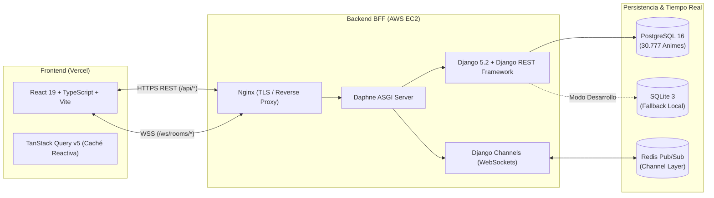

# 🎌 Animigos — Plataforma Social de Recomendación de Anime, Consenso Grupal y Watch Parties

**Animigos** es una plataforma web *full-stack* diseñada para resolver la fragmentación en el descubrimiento y consumo social de anime. Combina un **motor de recomendación híbrido** (capaz de cruzar gustos de cine/TV con más de 30.000 animes), un **algoritmo matemático de consenso grupal** (*Algoritmo de Felicidad*) y **salas interactivas en tiempo real** (*Watch Parties*) mediante WebSockets.

🌐 **Producción en vivo:**
- **Aplicación Web (Frontend — Vercel):** [https://www.animigos.app](https://www.animigos.app)
- **API REST & WebSockets (Backend — AWS EC2):** [https://api.animigos.app/api/](https://api.animigos.app/api/)

---

## ✨ Características y Módulos Principales

1. **🧠 Recomendador Inteligente y Test de Calibración (Profesor Doki Doki)**
   - Flujo guiado que captura películas/series live-action favoritas (vía TMDB), tropos narrativos, ritmo preferido y animes vistos.
   - **Filtrado anti-spoilers y de secuelas:** descarta automáticamente segundas temporadas o secuelas directas cuyos prerrequisitos el usuario no haya visto, consolidando franquicias en su punto de entrada canónico.
2. **🤝 Listas Grupales, Algoritmo de Felicidad y Watch Parties en Vivo**
   - Creación de salas compartidas mediante código de invitación.
   - **Algoritmo de Felicidad Grupal:** pondera la media de interés de los miembros, penaliza la dispersión (desacuerdo) para evitar polarización y genera explicaciones en lenguaje natural sobre el ganador del consenso.
   - **Sincronización en tiempo real (WebSockets):** chat en vivo, presencia de participantes, reacciones y control de estado con autoridad en el servidor (*Server-Authoritative Pattern*).
3. **📚 Catálogo Maestro (30.777 Animes) y Cronología de Temporadas**
   - Explorador con búsqueda instantánea, filtros multi-criterio (géneros, estudios, año, temporada, formato) y fichas técnicas completas con árbol de relaciones de franquicia, evolución histórica de puntaje e índice de polarización.
4. **📋 Mi Lista Personal y Agenda de Emisión**
   - Gestión de colección personal (*Viendo, Visto, Pendiente, Esperando, Dropeado*) con carpetas personalizadas, etiquetas, notas y actualizaciones optimistas.
   - **Agenda semanal:** cálculo automático de episodios atrasados en series en emisión y estimación de tiempo para ponerse al día.
5. **👥 Red Social, Solicitudes de Amistad y Tablón Comunitario**
   - Sistema bidireccional de solicitudes de amistad, sugerencias basadas en **amigos en común**, recomendaciones directas entre usuarios con notificaciones accionables y muro social con noticias de anime en español.
6. **🛡️ Perfil Analítico y Consola de Administración**
   - Dashboard personal con métricas de tiempo visto, distribución de notas, afinidad por género y personalización visual (banners, fondos laterales y catálogo de 845 avatares HD organizados por lotes con carga bajo demanda).
   - Portal administrativo protegido (`IsAdminUser`) para moderación y auditoría de la plataforma.

---

## 🏗️ Arquitectura del Sistema y Stack Tecnológico



### Stack Principal
- **Frontend:** React 19, TypeScript (`strict: true`), Vite 8, TanStack React Query v5, Bootstrap 6 + CSS Design Tokens propios, Lucide Icons.
- **Backend:** Python 3.12+, Django 5.2, Django REST Framework, Django Channels 4, Daphne (ASGI).
- **Base de Datos y Caché:** PostgreSQL 16 en producción (con conmutación híbrida automática a SQLite 3 con modo WAL en desarrollo local) y Redis 5 para pub/sub de WebSockets.
- **Infraestructura:** Frontend desplegado en **Vercel**; Backend desplegado en **AWS EC2 (Ubuntu 24.04 LTS)** con Nginx, systemd y certificados SSL/TLS vía Let's Encrypt.

---

## 📂 Estructura del Repositorio

```text
Animigos2/
├── animigos-frontend/               # Aplicación SPA en React 19 + TypeScript + Vite
│   ├── public/                      # Activos estáticos (logos e ilustraciones WebP)
│   └── src/
│       ├── admin/                   # Consola de administración y moderación
│       ├── components/              # Módulos de UI (catalogo, mi-lista, perfil, recomendador, tablon, watch-party)
│       ├── context/                 # Contexto de autenticación y sesión
│       ├── hooks/                   # Custom Hooks (useMyList, useRecommender, useWatchParty, useAgenda)
│       ├── services/                # Capa de servicios HTTP y abstracción de API
│       ├── shared/                  # Utilidades puras, cliente de caché y formateadores
│       └── utils/                   # Resolución de medios y helpers
│
├── animigos-backend/                # Servidor API REST y WebSockets (Django 5 + DRF + Channels)
│   ├── animes/                      # Catálogo, motor de recomendación híbrido y cruce TMDB
│   │   ├── data/                    # Datasets maestros (catálogo 30k, relaciones, historial de scores)
│   │   └── management/commands/     # Comandos CLI de ingesta y sincronización
│   ├── config/                      # Configuración central (settings híbrido, ASGI, URLs)
│   ├── core/                        # Utilidades transversales, caché, resiliencia de BD y noticias RSS
│   ├── groups/                      # Salas grupales, consumidores WebSocket y Algoritmo de Felicidad
│   ├── media/avatars/               # Catálogo de 845 avatares optimizados en WebP por lote de anime
│   ├── scripts/                     # Script de aprovisionamiento de cuentas administradoras (create_admins.py)
│   └── users/                       # Perfiles, listas personales, solicitudes de amistad y notificaciones
│
└── deploy/aws/                      # Configuración de infraestructura (Nginx, systemd Daphne y provisioning EC2)
```

---

## 🚀 Guía de Instalación y Ejecución Local

### 1. Requisitos Previos
- **Node.js** `>= 20.x` y `npm`
- **Python** `>= 3.11`
- **Git**

> **Nota sobre la Base de Datos:** El backend cuenta con detección automática de motor en `config/settings.py`. Si no configuras variables de PostgreSQL, utiliza automáticamente **SQLite 3** en local sin requerir servicios adicionales.

### 2. Levantar el Backend (Django + Daphne ASGI)

```bash
cd animigos-backend

# 1. Crear y activar entorno virtual
python -m venv .venv
# En Windows (PowerShell):
.\.venv\Scripts\Activate.ps1
# En Linux / macOS:
# source .venv/bin/activate

# 2. Instalar dependencias
pip install --upgrade pip
pip install -r requirements.txt

# 3. Aplicar migraciones
python manage.py migrate

# 4. (Opcional) Crear cuentas administradoras de prueba y poblar catálogo si la BD está vacía
python scripts/create_admins.py
python manage.py load_anime_bulk
python manage.py load_anime_relations

# 5. Iniciar el servidor ASGI en el puerto 8000
python manage.py runserver 127.0.0.1:8000
```

### 3. Levantar el Frontend (React + Vite)

En una segunda terminal:

```bash
cd animigos-frontend

# 1. Instalar dependencias
npm install

# 2. Iniciar servidor de desarrollo (con proxy automático hacia 127.0.0.1:8000)
npm run dev
```

Abre en tu navegador: **`http://localhost:5173/`**

---

## 📡 Resumen de Endpoints Principales de la API

| Módulo | Método | Endpoint | Descripción |
| :--- | :---: | :--- | :--- |
| **Catálogo** | `GET` | `/api/animes/` | Búsqueda paginada por género, estudio, temporada, año y texto |
| **Recomendador** | `POST` | `/api/animes/calibrate-recommendations/` | Motor híbrido (TMDB + tropos + afinidad de catálogo sin secuelas) |
| **Temporadas** | `GET` | `/api/animes/seasonal-schedule/` | Calendario semanal de emisiones y estrenos por estación |
| **Autenticación** | `POST` | `/api/users/login/` · `/api/users/register/` | Inicio de sesión y registro con cookies `HttpOnly` + token de sesión |
| **Mi Lista** | `GET/POST` | `/api/users/my-list/` | CRUD de lista personal de anime, carpetas y estadísticas |
| **Agenda** | `GET` | `/api/users/me/agenda/` | Episodios pendientes de series en emisión seguidas por el usuario |
| **Amistades** | `GET/POST` | `/api/users/me/friend-requests/` | Envío, aceptación/rechazo de solicitudes y sugerencias por amigos en común |
| **Salas Grupales** | `GET/POST` | `/api/groups/` | Creación de salas, postulación de candidatos, votación y consenso |
| **WebSockets** | `WSS` | `/ws/rooms/<room_id>/` | Canal en tiempo real para chat, presencia y estado de la Watch Party |
